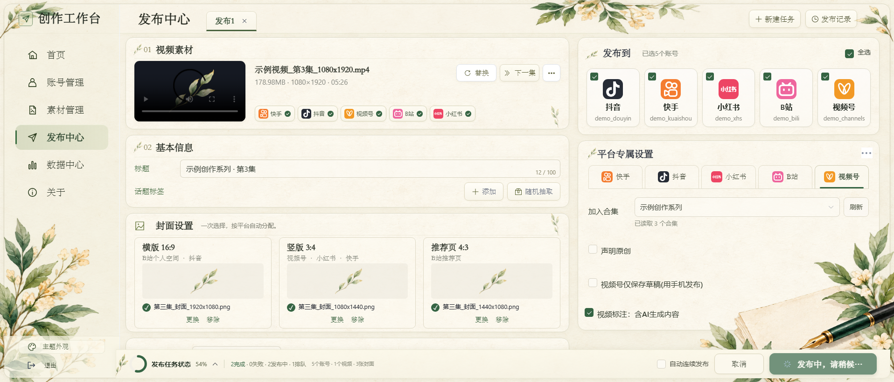
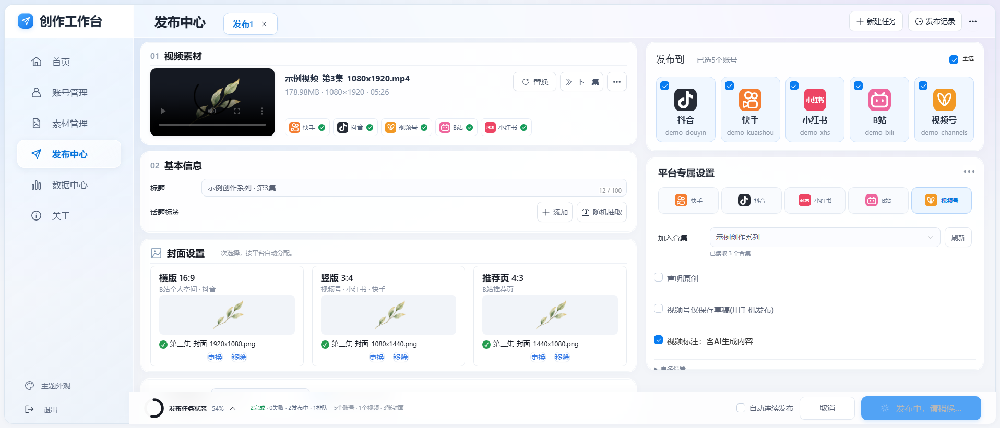

# 创作工作台 · Video Publication

基于 **[OmniPost](https://github.com/rehatRobot/omnipost)** 修改的多平台内容发布工作台。提供账号管理、按剧集整理素材、发布前检查、任务进度与历史记录，以及可切换的界面主题。

> **来源声明：本项目修改自 OmniPost，并非其官方发行版。** OmniPost 基于 [dreammis/social-auto-upload](https://github.com/dreammis/social-auto-upload)。感谢上游作者与社区贡献者；原始版权及 MIT 许可保留于 [LICENSE](LICENSE)，详见 [来源说明](NOTICE.md)。

## 相比 OmniPost 修改了什么

| 模块 | 本版本的修改 |
| --- | --- |
| 素材管理 | 本地文件夹关联、刷新同步、按集归类、分区管理与删除、文件夹批量移动；关联总目录后改选子目录时缩小同步范围；关联素材只登记路径，不复制文件 |
| 发布中心 | 共用横版、竖版和 B 站推荐页封面；下一集替换；恢复上次素材、配置及任务快照；账号独立合集选择 |
| 发布前检查 | 检查本地文件、登录文件、封面方向/集数、重复记录及视频号会话占用；整批预检失败时不提交任务 |
| 任务与记录 | SQLite 持久任务、请求去重、独立上传/封面/合集阶段、可拖动进度浮窗、发布记录核对和手动补记；重启不自动重发 |
| 账号后台 | 使用保存的登录状态打开官方后台，重复点击复用窗口；视频号后台、检测、合集读取和发布互斥，发布中优先显示现有页面 |
| 小红书 | 可选半自动流程：整理文案和文件位置，由用户在官方页面上传并确认；自动流程的提交结果核对与异常提示优化 |
| 平台适配 | 改进抖音封面处理、视频号封面弹窗、快手加载与合集关联、B 站封面与发布记录同步，以及小红书封面等待与提交核对 |
| 界面与主题 | 苹果浅色、复古植物水彩；导航底部切换并记住选择；共用双栏布局、等宽账号卡片与平台按钮、紧凑任务栏、发布记录弹窗 |
| 本机启动 | Windows 启停脚本、独立后台服务、服务日志与网页退出入口；本机接口来源校验 |

完整说明见 [CHANGELOG.md](CHANGELOG.md)。原 OmniPost README 保留在 [README.upstream.md](README.upstream.md)。

## 界面主题

首用默认启用“复古植物水彩”，也可在导航底部 **主题外观** 切回“苹果浅色”。主题选择只保存到当前浏览器，不修改账号、素材或任务。





新增主题的方法见 [主题扩展说明](sau_frontend/src/styles/THEMES.md)；水彩装饰的生成方式与提示词见 [素材说明](sau_frontend/public/themes/botanical/README.md)。装饰图片为 AI 生成，主题并非参考图的逐像素复制。

## 环境与安装

本机 Web 工作台以 **Windows 10/11、Python 3.10–3.12、Node.js 18+** 为目标；当前验证环境为 Windows / Python 3.12。其他系统可参考上游文档启动各服务，Windows 启停与本机文件选择功能不适用。

PowerShell 中执行：

```powershell
git clone https://github.com/QingHua27/Video-Publication.git
cd Video-Publication
Copy-Item conf.example.py conf.py
python -m venv .venv
.\.venv\Scripts\python.exe -m pip install -e ".[web]" -r requirements-local-web.txt
$env:PLAYWRIGHT_BROWSERS_PATH = Join-Path (Get-Location) '.browsers'
.\.venv\Scripts\python.exe -m patchright install chromium
.\.venv\Scripts\python.exe -m playwright install chromium
Push-Location db
..\.venv\Scripts\python.exe createTable.py
Pop-Location
npm --prefix sau_frontend install
npm --prefix sau_frontend run build
.\start.cmd
```

打开管理台：<http://127.0.0.1:5173/>。首次使用在“账号管理”添加自己的账号，在“素材管理”关联自己的文件夹。停止服务使用 `stop.cmd`；更新代码后先等待任务结束，再停止、安装新增依赖、重新构建并启动。

`conf.py` 可设置本机 Chrome 路径。账号后台打开使用系统 Chrome；B 站上传使用 biliup 运行时，首次使用可能需要联网下载。详细说明见 [本机安装](LOCAL-INSTALL.md) 和 [上游安装文档](docs/install.md)。

## 使用说明

- **已提交 / 流程完成不等于已发布或审核通过**，需在平台核对实际结果。
- 本地预检不联网验证登录是否仍有效。视频号手动后台用完后关闭窗口，再进行发布或检测。
- 删除素材分区会将素材和关联目录移至“未分区”，保留本地文件；删除素材记录不等于删除本地原文件。
- 小红书半自动模式由用户在官方页面操作；验证码、登录失效和权限问题需在平台处理。
- 各平台功能取决于账号权限与平台页面；本次自动测试使用本地夹具与模拟接口，未据此保证所有真实账号均可发布。

## 开发验证

```powershell
.\.venv\Scripts\python.exe -m unittest discover -s tests -p "test_*.py"
node --test sau_frontend/src/utils/*.test.mjs
npm --prefix sau_frontend run build
```

本仓库不包含 Cookie、登录配置、账号数据库、发布数据库、素材原文件、日志或本机调试探针。请自行创建配置和账号数据，不要将它们提交到公开仓库。

## 许可证与致谢

沿用 [MIT License](LICENSE)。来源链为 `dreammis/social-auto-upload → OmniPost → Video Publication`。请同时保留上游版权声明和来源说明。上游平台实现及文档归原作者与贡献者所有；本仓库新增修改由本项目贡献者维护。
